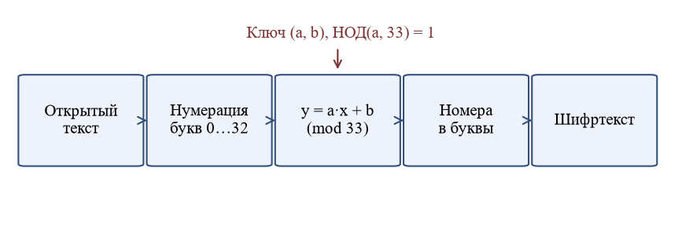
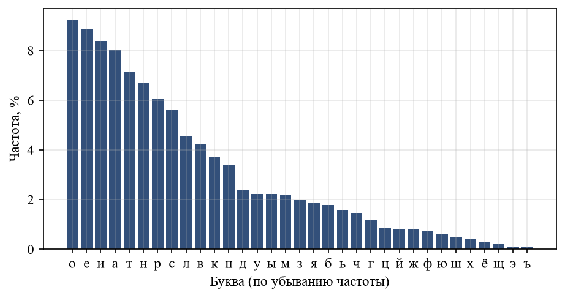
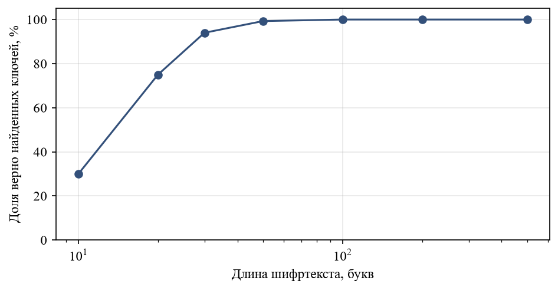
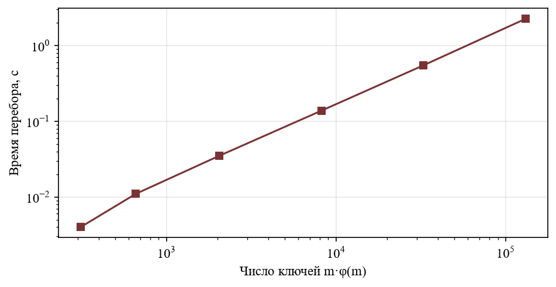

# Реферат

Объектом исследования является аффинный шифр подстановки, определённый над алфавитом русского языка.

Предметом исследования являются методы определения ключа аффинного шифра по шифртексту и по известному открытому тексту.

Цель работы – реализовать аффинный шифр и три метода его криптоанализа и экспериментально оценить их эффективность.

В процессе выполнения были рассмотрены основы модульной арифметики, алгоритм Евклида и его расширенный вариант, математическая модель аффинного шифра, получена оценка размера пространства ключей, изучены метод полного перебора, метод частотного анализа и метод анализа по известным парам «открытый текст – шифртекст».

В результате была разработана программа на языке Python, выполняющая шифрование, расшифрование и все три вида атак, проведены вычислительные эксперименты и показано, что при длине шифртекста от пятидесяти букв ключ определяется частотным анализом практически всегда.

# Содержание

# Введение

Защита информации от несанкционированного доступа остаётся одной из ключевых задач при построении информационных систем. Основным средством обеспечения конфиденциальности данных является шифрование, а потому знание принципов построения и вскрытия шифров необходимо специалисту по информационной безопасности [@stinson; @hac]. Несмотря на то что современные системы защиты опираются на стойкие алгоритмы, подробно описанные в стандартах [@gost34], изучение классических шифров не теряет значения. Именно на них удобно показать, из чего складывается криптографическая стойкость, чем отличается слабый шифр от сильного и почему практически любой шифр нужно рассматривать вместе с методами его вскрытия.

Особое место среди классических шифров занимает аффинный шифр. Он является простейшим представителем семейства шифров подстановки, в которых каждая буква открытого текста заменяется одной и той же буквой шифртекста независимо от её положения. Преобразование задаётся линейной функцией над кольцом вычетов, поэтому аффинный шифр обобщает шифр сдвига (шифр Цезаря) и одновременно является частным случаем шифра Хилла. Изучение этого шифра требует знания модульной арифметики, алгоритма Евклида и понятия обратного элемента, то есть тех же математических инструментов, на которых построены современные криптосистемы с открытым ключом [@rsa; @dh].

Аффинный шифр интересен ещё и тем, что на его примере хорошо видны границы применимости различных методов криптоанализа. Малое пространство ключей делает возможным полный перебор, статистические свойства языка открытого текста позволяют определить ключ по частотам букв, а линейность преобразования даёт возможность найти ключ по двум известным парам символов. Ещё в середине прошлого века К. Шеннон показал, что сохранение статистики открытого текста в шифртексте приводит к принципиальной уязвимости шифра [@shannon]. Аффинный шифр наглядно иллюстрирует это положение.

Целью данной работы является реализация аффинного шифра над алфавитом русского языка и методов его криптоанализа, а также экспериментальная оценка эффективности этих методов.

Для достижения цели были поставлены следующие задачи:

- изучить теоретические основы: модульную арифметику, алгоритм Евклида и математическую модель аффинного шифра;
- рассмотреть методы криптоанализа аффинного шифра и оценить размер пространства ключей;
- разработать программную реализацию шифра и методов его вскрытия на языке Python;
- провести вычислительные эксперименты и проанализировать полученные результаты.

Структура работы соответствует перечню задач. В первом разделе изложены теоретические основы, во втором описана программная реализация, в третьем приведены результаты экспериментов и их анализ. В приложении А приведён полный листинг программы, в приложении Б – таблицы с результатами.

# Теоретические основы

## Модульная арифметика

Основой аффинного шифра служит арифметика остатков. Пусть $m$ – натуральное число больше единицы. Два целых числа $a$ и $b$ называются сравнимыми по модулю $m$, если их разность делится на $m$ без остатка [@stinson]. Этот факт записывается в виде:

$$ a \equiv b \pmod m \iff m \mid (a - b) $$ {#eq-cong}

Отношение сравнимости является отношением эквивалентности: оно рефлексивно, симметрично и транзитивно. Поэтому множество целых чисел разбивается на $m$ классов эквивалентности, называемых классами вычетов по модулю $m$. Каждый класс содержит все числа, дающие один и тот же остаток при делении на $m$. В качестве представителя класса обычно берут наименьший неотрицательный остаток, то есть число из набора $\{0, 1, \dots, m-1\}$. Множество классов вычетов обозначают $\mathbb{Z}_m$.

Сравнения по одному модулю можно складывать и умножать почленно. Если $a \equiv a' \pmod m$ и $b \equiv b' \pmod m$, то справедливы равенства:

$$ a + b \equiv a' + b' \pmod m, \qquad a \cdot b \equiv a' \cdot b' \pmod m $$ {#eq-ring}

Благодаря свойствам ([[eq-ring]]) множество $\mathbb{Z}_m$ с операциями сложения и умножения по модулю $m$ образует коммутативное кольцо с единицей. Вычитание в этом кольце определено всегда, а деление – не всегда. Именно ограничения на деление и определяют условия, при которых аффинный шифр обратим.

Перечислим основные свойства, которые используются в дальнейшем:

1) сложение и умножение в $\mathbb{Z}_m$ коммутативны и ассоциативны, а умножение дистрибутивно относительно сложения;
2) для каждого элемента $x$ существует противоположный элемент $-x$, для которого $x + (-x) \equiv 0 \pmod m$;
3) элемент $x$ имеет обратный по умножению тогда и только тогда, когда $x$ и $m$ взаимно просты;
4) число обратимых элементов кольца $\mathbb{Z}_m$ равно значению функции Эйлера $\varphi(m)$.

Функция Эйлера $\varphi(m)$ равна количеству чисел от $1$ до $m$, взаимно простых с $m$. Для простого $p$ имеем $\varphi(p) = p - 1$, а для произведения взаимно простых чисел $\varphi(m_1 m_2) = \varphi(m_1)\varphi(m_2)$. Эти правила позволяют вычислить функцию Эйлера для любого $m$, если известно его разложение на простые множители. Для алфавита русского языка, содержащего $m = 33$ буквы, получаем:

$$ \varphi(33) = \varphi(3) \cdot \varphi(11) = 2 \cdot 10 = 20 $$ {#eq-phi}

Таким образом, в кольце $\mathbb{Z}_{33}$ ровно двадцать обратимых элементов. Остальные тринадцать ненулевых элементов делятся на $3$ или на $11$ и обратных не имеют. Полный список обратимых элементов вместе с обратными к ним приведён в приложении [[app-tables]] (таблица [[tab-units]]).

## Алгоритм Евклида и обратный элемент

Для практического вычисления обратного элемента используется алгоритм Евклида. Он находит наибольший общий делитель двух чисел с помощью последовательного деления с остатком [@cormen]. Если $a = q b + r$, где $0 \le r < b$, то справедливо равенство:

$$ \gcd(a, b) = \gcd(b, r) $$ {#eq-euclid}

Применяя равенство ([[eq-euclid]]) многократно, мы получаем убывающую последовательность остатков, которая обрывается на нуле. Последний ненулевой остаток и есть наибольший общий делитель. Число шагов алгоритма растёт логарифмически по отношению к меньшему из чисел, поэтому он эффективен даже для очень больших аргументов [@knuth].

Расширенный алгоритм Евклида дополнительно находит целые коэффициенты $x$ и $y$ соотношения Безу:

$$ a x + b y = \gcd(a, b) $$ {#eq-bezout}

Если $\gcd(a, m) = 1$, то из соотношения ([[eq-bezout]]) при $b = m$ получаем $a x \equiv 1 \pmod m$, то есть число $x$ является обратным к $a$ по модулю $m$. В этом случае используется обозначение $a^{-1}$. Порядок действий при вычислении обратного элемента следующий:

1) выполнить алгоритм Евклида для пары $(m, a)$ и записать все частные и остатки;
2) убедиться, что последний ненулевой остаток равен единице, иначе обратного элемента не существует;
3) для каждого шага вычислить коэффициенты соотношения Безу по рекуррентным формулам;
4) привести коэффициент при $a$ к диапазону от $0$ до $m - 1$.

Рассмотрим пример: найдём элемент, обратный к $7$ по модулю $33$. Ход вычислений показан в таблице [[tab-euclid]]. В первом столбце указан номер шага, во втором – остаток, в третьем – частное, в двух последних – коэффициенты при $33$ и при $7$ соответственно.

Таблица: Расширенный алгоритм Евклида для пары (33, 7) {#tab-euclid}

| Шаг | Остаток $r_i$ | Частное $q_i$ | Коэффициент $x_i$ | Коэффициент $y_i$ |
|:---:|:---:|:---:|:---:|:---:|
| 0 | 33 | – | 1 | 0 |
| 1 | 7 | 4 | 0 | 1 |
| 2 | 5 | 1 | 1 | −4 |
| 3 | 2 | 2 | −1 | 5 |
| 4 | 1 | 2 | 3 | −14 |
| 5 | 0 | – | – | – |

Последний ненулевой остаток равен единице, значит, числа $33$ и $7$ взаимно просты. Из строки с номером 4 получаем соотношение:

$$ 33 \cdot 3 + 7 \cdot (-14) = 1 $$ {#eq-bez-example}

Следовательно, $7^{-1} \equiv -14 \equiv 19 \pmod{33}$. Проверка: $7 \cdot 19 = 133 = 4 \cdot 33 + 1$, то есть произведение действительно даёт единицу по модулю $33$. Именно такой способ вычисления реализован в программе (функция `inverse`, см. приложение [[app-code]]).

## Аффинный шифр

### Описание преобразования

Пронумеруем буквы алфавита подряд числами от $0$ до $m - 1$. Для русского алфавита с буквой «ё» получим $m = 33$; соответствие букв и номеров приведено в таблице [[tab-letters]]. Открытый текст представляется последовательностью чисел $x_1, x_2, \dots, x_n$, где $x_i \in \mathbb{Z}_m$.

Ключом аффинного шифра является пара чисел $(a, b)$, где $b \in \mathbb{Z}_m$ – сдвиг, а $a \in \mathbb{Z}_m$ – множитель, обязательно взаимно простой с $m$. Каждая буква шифруется по формуле:

$$ y = E_{a,b}(x) = (a x + b) \bmod m $$ {#eq-enc}

Расшифрование выполняется обратным преобразованием, которое существует, только если множитель $a$ обратим:

$$ x = D_{a,b}(y) = a^{-1} (y - b) \bmod m $$ {#eq-dec}

Корректность формул проверяется прямой подстановкой: $D_{a,b}(E_{a,b}(x)) = a^{-1}(a x + b - b) = x$. При $a = 1$ шифр вырождается в шифр сдвига, а при $b = 0$ называется шифром умножения. Общая схема преобразования показана на рисунке [[fig-scheme]].

{#fig-scheme width=15cm}

Условие $\gcd(a, m) = 1$ существенно. Если оно нарушено, то разные буквы открытого текста могут шифроваться одной и той же буквой, и однозначное расшифрование становится невозможным. Например, при $m = 33$ и $a = 3$ буквы с номерами $0$, $11$ и $22$ переходят в одну и ту же букву при любом $b$, поскольку числа $3 \cdot 0$, $3 \cdot 11$ и $3 \cdot 22$ кратны $33$.

Таблица: Соответствие букв русского алфавита числам и их частоты {#tab-letters}

| Буква | Номер | Частота, % | Буква | Номер | Частота, % |
|:---:|:---:|:---:|:---:|:---:|:---:|
| а | 0 | 8,02 | р | 17 | 6,07 |
| б | 1 | 1,78 | с | 18 | 5,61 |
| в | 2 | 4,22 | т | 19 | 7,14 |
| г | 3 | 1,18 | у | 20 | 2,22 |
| д | 4 | 2,40 | ф | 21 | 0,71 |
| е | 5 | 8,87 | х | 22 | 0,43 |
| ё | 6 | 0,31 | ц | 23 | 0,87 |
| ж | 7 | 0,78 | ч | 24 | 1,46 |
| з | 8 | 1,97 | ш | 25 | 0,48 |
| и | 9 | 8,38 | щ | 26 | 0,20 |
| й | 10 | 0,79 | ъ | 27 | 0,07 |
| к | 11 | 3,69 | ы | 28 | 2,21 |
| л | 12 | 4,55 | ь | 29 | 1,56 |
| м | 13 | 2,16 | э | 30 | 0,10 |
| н | 14 | 6,71 | ю | 31 | 0,63 |
| о | 15 | 9,22 | я | 32 | 1,84 |
| п | 16 | 3,37 |  |  |  |

Разберём числовой пример. Зашифруем слово «криптография» ключом $(a, b) = (7, 3)$. Обратный элемент $7^{-1} = 19$ найден выше. Результат шифрования каждой буквы показан в таблице [[tab-example]]. Шифртекст имеет вид «нцапдичцгсаь», и расшифрование по формуле ([[eq-dec]]) возвращает исходное слово.

Таблица: Шифрование слова «криптография» ключом (7, 3) {#tab-example}

| Буква | Номер $x$ | $7x + 3$ | $y = (7x+3) \bmod 33$ | Шифр |
|:---:|:---:|:---:|:---:|:---:|
| к | 11 | 80 | 14 | н |
| р | 17 | 122 | 23 | ц |
| и | 9 | 66 | 0 | а |
| п | 16 | 115 | 16 | п |
| т | 19 | 136 | 4 | д |
| о | 15 | 108 | 9 | и |
| г | 3 | 24 | 24 | ч |
| р | 17 | 122 | 23 | ц |
| а | 0 | 3 | 3 | г |
| ф | 21 | 150 | 18 | с |
| и | 9 | 66 | 0 | а |
| я | 32 | 227 | 29 | ь |

Отметим особенность, которая будет использована при криптоанализе: одинаковые буквы открытого текста всегда дают одинаковые буквы шифртекста. В слове из примера буква «р» встречается дважды, и оба раза она заменена буквой «ц»; то же относится к буквам «и» и «а».

### Пространство ключей

Число допустимых ключей определяется числом возможных значений множителя и сдвига. Множитель выбирается среди $\varphi(m)$ обратимых элементов, сдвиг – среди всех $m$ вычетов, поэтому размер пространства ключей равен:

$$ |K| = m \cdot \varphi(m) $$ {#eq-keys}

Для $m = 33$ получаем $|K| = 33 \cdot 20 = 660$ ключей. Среди них есть тождественный ключ $(1, 0)$, который не меняет текст, поэтому на практике он исключается. Если же алфавит состоит из $m = 26$ букв, то $|K| = 26 \cdot 12 = 312$. В таблице [[tab-keys]] приведены значения $|K|$ для алфавитов разного размера; эти значения получены в ходе экспериментов, описанных в третьем разделе.

Столь малое пространство ключей делает аффинный шифр непригодным для защиты реальных данных. Даже полный перебор вручную потребовал бы просмотра нескольких сотен вариантов, а на компьютере – ничтожных долей секунды. Требование к современным шифрам существенно жёстче: пространство ключей должно быть настолько велико, чтобы полный перебор был невозможен на практике [@stinson].

## Методы криптоанализа

### Полный перебор ключей

Самый простой метод вскрытия состоит в последовательной проверке всех ключей. Для каждой пары $(a, b)$ шифртекст расшифровывается, а результат оценивается: правильному ключу должен соответствовать осмысленный текст. Автоматизировать оценку «осмысленности» можно с помощью статистических критериев, о которых пойдёт речь в следующем подразделе. Трудоёмкость метода пропорциональна $|K|$, то есть растёт примерно квадратично с ростом размера алфавита, поскольку $\varphi(m)$ имеет порядок $m$ для большинства $m$.

### Частотный анализ {#sec-freq-results}

Частотный анализ использует тот факт, что в любом естественном языке буквы встречаются с разной частотой. Для русского языка наиболее частыми являются гласные «о», «е», «а», «и» и согласные «н», «т», «с», «р». Аффинный шифр не скрывает эту неравномерность: он лишь переставляет частоты между буквами. Следовательно, при достаточной длине шифртекста частоты букв шифртекста повторяют упорядоченный набор частот языка, а сопоставив наиболее частые буквы, можно вычислить ключ.

Формализуем оценку. Пусть $p_c$ – вероятность буквы $c$ в языке открытого текста, определённая по обучающему тексту. Для гипотезы $(a, b)$ получим расшифрованный текст $t_1 t_2 \dots t_n$ и оценим логарифм его правдоподобия:

$$ L(a, b) = \sum_{i=1}^{n} \ln p_{t_i} $$ {#eq-loglik}

Ключом признаётся пара, дающая наибольшее значение $L(a, b)$. Такой критерий учитывает частоты всех букв, а не только наиболее частых, и потому устойчивее к случайным отклонениям на коротких текстах. Основное ограничение метода – зависимость от длины шифртекста: чем короче текст, тем сильнее выборочные частоты отличаются от теоретических. Зависимость точности от длины исследована в подразделе [[sec-freq-results]].

### Анализ по известному открытому тексту

Пусть противнику известны две пары соответствующих символов $(x_1, y_1)$ и $(x_2, y_2)$, где $x_1 \ne x_2$. Тогда ключ должен удовлетворять системе сравнений:

$$ \begin{cases} (a x_1 + b) \bmod m \equiv y_1, \\ (a x_2 + b) \bmod m \equiv y_2 \end{cases} $$ {#eq-system}

Вычитая второе сравнение из первого, получим сравнение относительно $a$:

$$ \begin{aligned} a (x_1 - x_2) &\equiv y_1 - y_2 \pmod m \end{aligned} $$ {#eq-diff}

Если разность $d = x_1 - x_2$ взаимно проста с $m$, то обратный элемент $d^{-1}$ существует, и множитель определяется однозначно:

$$ a \equiv (y_1 - y_2) \cdot d^{-1} \pmod m, \qquad b \equiv y_1 - a x_1 \pmod m $$ {#eq-solve}

Если же $g = \gcd(d, m) > 1$, то сравнение ([[eq-diff]]) разрешимо только при условии, что $g$ делит $y_1 - y_2$, и тогда оно имеет ровно $g$ решений по модулю $m$. Часть из них не годится в качестве множителя, так как не взаимно проста с $m$, и остаётся несколько кандидатов, для различения которых нужна третья пара символов. Эти рассуждения подтверждены экспериментом в подразделе [[sec-kpa-results]].

# Программная реализация

## Состав программы

Программа написана на языке Python и состоит из двух модулей. Модуль `affine.py` содержит все функции шифра и методов вскрытия, а модуль `experiments.py` выполняет вычислительные эксперименты и строит графики. Для построения графиков использована библиотека Matplotlib [@mpl], для работы со строками и числами – стандартная библиотека, в частности модуль `math` [@pydoc]. Полный листинг модуля `affine.py` приведён в приложении [[app-code]].

Перечень основных функций модуля:

- `normalize` – приведение текста к нижнему регистру и удаление всех символов, кроме букв алфавита;
- `egcd` и `inverse` – расширенный алгоритм Евклида и вычисление обратного элемента;
- `euler_phi` – вычисление функции Эйлера;
- `encrypt` и `decrypt` – шифрование и расшифрование по формулам ([[eq-enc]]) и ([[eq-dec]]);
- `frequencies` и `log_score` – вычисление частот и оценки правдоподобия по формуле ([[eq-loglik]]);
- `brute_force` – перебор ключей с выбором наилучшего по правдоподобию;
- `known_plaintext` – решение системы ([[eq-system]]).

Такое разделение позволяет использовать одни и те же примитивы и в шифровании, и в атаках, а также упрощает тестирование: любую функцию можно проверить отдельно.

## Реализация основных функций

Расширенный алгоритм Евклида реализован итеративно, без рекурсии, поэтому не зависит от ограничения на глубину вызовов. Ниже приведён фрагмент, отвечающий за вычисление коэффициентов соотношения Безу ([[eq-bezout]]).

```python
def egcd(a, b):
    x0, y0, x1, y1 = 1, 0, 0, 1
    while b:
        q = a // b
        a, b = b, a - q * b
        x0, x1 = x1, x0 - q * x1
        y0, y1 = y1, y0 - q * y1
    return a, x0, y0
```

Функция возвращает наибольший общий делитель и коэффициенты. На её основе построена функция `inverse`, которая вызывает исключение, если число не имеет обратного элемента. Благодаря этому попытка зашифровать текст с недопустимым множителем завершается понятной ошибкой, а не искажением данных.

Шифрование и расшифрование записаны одной строкой каждое и повторяют формулы ([[eq-enc]]) и ([[eq-dec]]). Фрагмент функции шифрования:

```python
def encrypt(text, a, b, alphabet=ALPHABET):
    m = len(alphabet)
    if gcd(a, m) != 1:
        raise ValueError("ключ a должен быть взаимно прост с m")
    return "".join(alphabet[(a * alphabet.index(ch) + b) % m] for ch in text)
```

Метод частотного анализа использует функцию `brute_force`. Для каждой допустимой пары ключей она расшифровывает текст, вычисляет оценку ([[eq-loglik]]) и запоминает лучший вариант. Чтобы исключить деление на ноль при вычислении логарифма, нулевые частоты в эталоне заменяются малым положительным числом.

Для атаки по известному открытому тексту реализована функция `known_plaintext`. Она учитывает случай, когда разность $x_1 - x_2$ не взаимно проста с модулем: в этом случае возвращается весь набор ключей, удовлетворяющих системе, а не единственный ключ. Это позволяет честно оценить неоднозначность, а не скрывать её.

## Методика экспериментов

Эксперименты выполнялись на персональном компьютере под управлением Windows; все случайные величины получены от генератора с фиксированным начальным значением, поэтому результаты воспроизводимы. Для частотного анализа необходим текст, по которому строится эталонное распределение, и отдельный текст, из которого берутся фрагменты для шифрования. Чтобы исключить завышение точности из-за совпадения текстов, они были разделены:

- обучающий текст объёмом 12 065 букв, по которому построено эталонное распределение частот;
- тестовый текст объёмом 8 021 буква, из которого случайно выбирались фрагменты заданной длины.

В обоих случаях использовались технические тексты на русском языке из документации проекта. Следует учитывать, что частоты букв в технических текстах несколько отличаются от частот художественной литературы; это одна из причин, по которой результаты на коротких фрагментах не являются предельными.

Каждое испытание состояло из следующих действий:

а) выбор случайного допустимого ключа $(a, b)$;
б) шифрование случайно выбранного фрагмента тестового текста;
в) выполнение соответствующей атаки над полученным шифртекстом;
г) сравнение результата атаки с исходными данными.

Атака считалась успешной, если расшифрованный с найденным ключом текст совпал с исходным. Для каждого значения длины фрагмента проводилось по 300 испытаний.

# Результаты экспериментов

## Пространство ключей

В первом эксперименте определялся размер пространства ключей для алфавитов разной мощности. Результаты приведены в таблице [[tab-keys]]. Для русского алфавита из 33 букв получено значение $|K| = 660$, что совпадает с расчётом по формуле ([[eq-keys]]).

Таблица: Размер пространства ключей аффинного шифра {#tab-keys}

| Размер алфавита $m$ | $\varphi(m)$ | Число ключей $m\varphi(m)$ |
|:---:|:---:|:---:|
| 26 | 12 | 312 |
| 32 | 16 | 512 |
| 33 | 20 | 660 |
| 36 | 12 | 432 |
| 64 | 32 | 2048 |
| 128 | 64 | 8192 |
| 256 | 128 | 32768 |

Из таблицы видно, что число ключей определяется не только размером алфавита, но и его арифметическими свойствами. Например, при $m = 32$, являющемся степенью двойки, обратимыми оказываются только нечётные числа, поэтому $\varphi(32) = 16$, а при $m = 36$ значение $\varphi(36) = 12$ меньше, чем у алфавита из 33 букв, хотя сам алфавит больше. Практический вывод: для увеличения пространства ключей выгоднее выбирать модуль с малым числом простых делителей, в пределе – простое число, для которого $\varphi(m) = m - 1$.

## Частотный анализ

Прежде всего была получена частотная картина обучающего текста. Распределение частот букв показано на рисунке [[fig-freq]]; наиболее частыми оказались буквы «о» (9,22 %), «е» (8,87 %), «и» (8,38 %), «а» (8,02 %) и «т» (7,14 %). Полные значения частот всех 33 букв приведены в таблице [[tab-letters]].

{#fig-freq width=12cm}

Распределение резко неравномерно: самые частые буквы встречаются более чем в девяносто раз чаще самых редких («ъ» и «э»). Именно эта неравномерность и позволяет вскрывать шифр. Далее для каждой длины шифртекста определялась доля случаев, когда метод правдоподобия ([[eq-loglik]]) находил верный ключ. Числовые результаты сведены в таблицу [[tab-success]], график показан на рисунке [[fig-success]].

Таблица: Доля верно найденных ключей при частотном анализе {#tab-success}

| Длина шифртекста, букв | Испытаний | Успешных | Доля успеха, % |
|:---:|:---:|:---:|:---:|
| 10 | 300 | 90 | 30,0 |
| 20 | 300 | 225 | 75,0 |
| 30 | 300 | 282 | 94,0 |
| 50 | 300 | 298 | 99,3 |
| 100 | 300 | 300 | 100,0 |
| 200 | 300 | 300 | 100,0 |
| 500 | 300 | 300 | 100,0 |

{#fig-success width=12cm}

Результаты показывают, что при длине шифртекста в десять букв ключ находится лишь в 30 % случаев, при двадцати буквах – в 75 %, а начиная с пятидесяти букв доля успеха превышает 99 %. Для текстов в сто и более букв все 300 испытаний завершились успехом. Практически важный вывод состоит в том, что для надёжного вскрытия достаточно очень коротких сообщений: одной-двух строк обычного текста. Это существенно ниже объёма, который современные шифры обязаны выдерживать без раскрытия ключа.

Причина неудач на коротких текстах понятна: при десяти буквах выборочные частоты определяются слишком случайно, и несколько ключей дают расшифрованный текст с близким правдоподобием. Подробные значения приведены также в приложении [[app-tables]] (таблица [[tab-success-raw]]).

## Атака по известному открытому тексту {#sec-kpa-results}

Для проверки рассуждений подраздела о системе сравнений были перебраны все 1 056 упорядоченных пар различных букв алфавита $(x_1, x_2)$. Для каждой пары по 20 раз выбирался случайный допустимый ключ, строились шифрбуквы $y_1$ и $y_2$ и решалась система ([[eq-system]]). Результаты показаны в таблице [[tab-kpa]].

Таблица: Результаты атаки по двум известным парам символов {#tab-kpa}

| Исход | Число испытаний | Доля, % |
|:---|:---:|:---:|
| Ключ определён однозначно | 13 200 | 62,5 |
| Найдено несколько ключей | 7 920 | 37,5 |
| Система несовместна | 0 | 0,0 |
| Всего | 21 120 | 100,0 |

Доля однозначных исходов в точности равна $20/32 = 62{,}5\ \%$, то есть отношению числа ненулевых разностей, взаимно простых с $33$, к общему числу ненулевых разностей. Это полностью совпадает с теорией: однозначность наступает тогда и только тогда, когда $\gcd(x_1 - x_2,\, 33) = 1$. Несовместных систем нет, поскольку все пары получены с реальным ключом.

Рассмотрим пример неоднозначного случая. Пусть известны пары «к» и «р» открытого текста, номера которых равны $11$ и $17$, и соответствующие им буквы шифртекста «н» и «ц» с номерами $14$ и $23$. Составим систему вида ([[eq-system]]):

$$ \begin{cases} (11 a + b) \bmod 33 \equiv 14, \\ (17 a + b) \bmod 33 \equiv 23 \end{cases} $$ {#eq-example-system}

Вычитая второе сравнение из первого, получим $-6 a \equiv -9 \pmod{33}$, или $6 a \equiv 9 \pmod{33}$. Наибольший общий делитель чисел $6$ и $33$ равен $3$ и делит $9$, поэтому сравнение разрешимо. Разделив обе части и модуль на $3$, имеем $2a \equiv 3 \pmod{11}$, откуда $a \equiv 3 \cdot 6 \equiv 7 \pmod{11}$. Подходят значения $a \in \{7, 18, 29\}$; число $18$ не взаимно просто с $33$, поэтому остаются два кандидата. Для них находим сдвиг по формуле ([[eq-solve]]):

$$ (a, b) \in \{(7, 3),\ (29, 25)\} $$ {#eq-candidates}

Программа вернула в точности эти два ключа. Истинным в примере был ключ $(7, 3)$, но по двум парам символов отличить его от ключа $(29, 25)$ нельзя. Чтобы сделать выбор, достаточно проверить расшифрованный текст на осмысленность или использовать третью пару с разностью, взаимно простой с модулем.

## Время полного перебора

Последний эксперимент посвящён трудоёмкости полного перебора. Для алфавитов разной мощности измерялось время, необходимое для перебора всех допустимых ключей и оценки каждого варианта на тексте из 50 символов. Результаты приведены в таблице [[tab-time]] и на рисунке [[fig-time]].

Таблица: Время полного перебора ключей {#tab-time}

| Размер алфавита $m$ | Число ключей | Время, с |
|:---:|:---:|:---:|
| 26 | 312 | 0,004 |
| 33 | 660 | 0,011 |
| 64 | 2 048 | 0,035 |
| 128 | 8 192 | 0,138 |
| 256 | 32 768 | 0,549 |
| 512 | 131 072 | 2,259 |

{#fig-time width=12cm}

График в логарифмических координатах близок к прямой с единичным наклоном, то есть время растёт пропорционально числу ключей, что согласуется с теоретической оценкой трудоёмкости. Для алфавита из 33 букв перебор занимает около одной сотой секунды, а даже для алфавита из 512 символов – чуть более двух секунд. Время зависит от компьютера и реализации, но порядок величин показывает, что противодействовать перебору при столь малом пространстве ключей невозможно.

## Обсуждение результатов

Совокупность экспериментов подтверждает, что аффинный шифр обладает тремя независимыми уязвимостями. Во-первых, пространство ключей мало: $|K| = 660$ для русского алфавита, и полный перебор выполняется за ничтожное время. Во-вторых, шифр не скрывает статистику языка, поэтому частотный анализ определяет ключ по тексту длиной от пятидесяти букв почти всегда. В-третьих, линейность преобразования позволяет найти ключ по двум известным парам символов, если разность их номеров взаимно проста с модулем, а в остальных случаях сводит поиск к небольшому набору кандидатов.

Отметим ограничения проведённых экспериментов. Эталонное распределение построено по сравнительно небольшому тексту, а тексты относятся к одному стилю. Для художественных текстов или текстов с другой лексикой доля успеха на коротких фрагментах может отличаться. Кроме того, эксперименты не учитывали пробелы и знаки препинания: считалось, что противник знает границы слов не лучше, чем без шифрования, то есть работает только с последовательностью букв. Тем не менее эти ограничения не влияют на главный вывод о недопустимости использования аффинного шифра для защиты информации.

Методы, рассмотренные в работе, имеют и более общее значение. Принцип использования статистики языка лежит в основе вскрытия всех моноалфавитных шифров подстановки, а идея решения линейной системы по известным парам распространяется на шифр Хилла. Алгоритмы вычисления обратного элемента применяются и в современных асимметричных системах, например при генерации ключей RSA [@rsa].

# Заключение

В ходе работы были изучены математические основы аффинного шифра: сравнения по модулю, функция Эйлера, алгоритм Евклида и вычисление обратного элемента. Построена математическая модель шифра, выведены формулы шифрования и расшифрования и получена оценка размера пространства ключей $|K| = m\varphi(m)$, которая для русского алфавита даёт 660 ключей.

Рассмотрены три метода криптоанализа: полный перебор, частотный анализ с оценкой правдоподобия и анализ по известному открытому тексту. Все они реализованы на языке Python в виде отдельных функций, листинг приведён в приложении А. Проведены вычислительные эксперименты, показавшие, что частотный анализ находит ключ в 99,3 % случаев при длине шифртекста пятьдесят букв и во всех испытаниях при ста буквах, что полный перебор занимает около одной сотой секунды, а доля однозначных решений системы по двум известным парам символов составляет 62,5 %, что совпадает с теоретической оценкой.

Таким образом, поставленная цель достигнута, а все задачи решены. Дальнейшим развитием работы может стать исследование шифра Хилла и вскрытия по известному открытому тексту при большей размерности матрицы, а также сравнение методов оценки правдоподобия на текстах разных стилей. Отдельного внимания заслуживает вопрос о противодействии статистическим атакам: использование полиалфавитных шифров и современных блочных шифров, подобных описанным в стандарте [@gost34].

# Список использованных источников

# Приложение: Листинг программы {#app-code}

## Модуль affine.py

Ниже приведён полный текст модуля с функциями шифра и методов вскрытия. Модуль `experiments.py`, выполняющий эксперименты, запускается командой `python experiments.py`.

```python
"""Аффинный шифр над русским алфавитом и методы его криптоанализа (учебная реализация)."""
from collections import Counter
from math import gcd, log

ALPHABET = "абвгдеёжзийклмнопрстуфхцчшщъыьэюя"   # 33 буквы, m = 33
M = len(ALPHABET)


def normalize(text, alphabet=ALPHABET):
    """Оставляет только буквы алфавита в нижнем регистре."""
    return "".join(ch for ch in text.lower() if ch in alphabet)


def egcd(a, b):
    """Расширенный алгоритм Евклида: возвращает (g, x, y), где a*x + b*y = g = НОД(a, b)."""
    x0, y0, x1, y1 = 1, 0, 0, 1
    while b:
        q = a // b
        a, b = b, a - q * b
        x0, x1 = x1, x0 - q * x1
        y0, y1 = y1, y0 - q * y1
    return a, x0, y0


def inverse(a, m):
    """Обратный элемент a^(-1) по модулю m; ошибка, если НОД(a, m) != 1."""
    g, x, _ = egcd(a % m, m)
    if g != 1:
        raise ValueError(f"{a} не обратим по модулю {m}")
    return x % m


def euler_phi(n):
    """Функция Эйлера: число чисел от 1 до n, взаимно простых с n."""
    return sum(1 for k in range(1, n + 1) if gcd(k, n) == 1)


def encrypt(text, a, b, alphabet=ALPHABET):
    m = len(alphabet)
    if gcd(a, m) != 1:
        raise ValueError("ключ a должен быть взаимно прост с m")
    return "".join(alphabet[(a * alphabet.index(ch) + b) % m] for ch in text)


def decrypt(text, a, b, alphabet=ALPHABET):
    m, a_inv = len(alphabet), inverse(a, len(alphabet))
    return "".join(alphabet[(a_inv * (alphabet.index(ch) - b)) % m] for ch in text)


def frequencies(text, alphabet=ALPHABET):
    """Относительные частоты букв текста."""
    counts, n = Counter(text), max(len(text), 1)
    return {ch: counts[ch] / n for ch in alphabet}


def log_score(text, reference):
    """Логарифм правдоподобия текста при эталонном распределении букв (чем больше, тем лучше)."""
    return sum(log(reference[ch]) for ch in text)


def brute_force(cipher, reference, alphabet=ALPHABET):
    """Полный перебор ключей; лучший ключ выбирается по правдоподобию. Возвращает (a, b, оценка)."""
    m = len(alphabet)
    best = None
    for a in range(1, m):
        if gcd(a, m) != 1:
            continue
        for b in range(m):
            score = log_score(decrypt(cipher, a, b, alphabet), reference)
            if best is None or score > best[2]:
                best = (a, b, score)
    return best


def known_plaintext(x1, y1, x2, y2, m=M):
    """Все ключи (a, b), удовлетворяющие системе a*x_i + b = y_i (mod m), i = 1, 2."""
    d, e = (x1 - x2) % m, (y1 - y2) % m
    g = gcd(d, m)
    if e % g:
        return []                                  # система несовместна
    m_g = m // g
    a0 = (e // g) * inverse(d // g, m_g) % m_g if m_g > 1 else 0
    keys = []
    for k in range(g):                             # g решений по модулю m
        a = a0 + k * m_g
        if gcd(a, m) == 1:
            keys.append((a, (y1 - a * x1) % m))
    return keys
```

# Приложение: Таблицы с результатами {#app-tables}

## Обратимые элементы кольца вычетов

В таблице [[tab-units]] приведены все двадцать элементов кольца $\mathbb{Z}_{33}$, имеющих обратный, и соответствующие обратные элементы.

Таблица: Обратимые элементы кольца $\mathbb{Z}_{33}$ и обратные к ним {#tab-units}

| Элемент $a$ | Обратный элемент $a^{-1}$ | Проверка $a \cdot a^{-1} \bmod 33$ |
|:---:|:---:|:---:|
| 1 | 1 | 1 |
| 2 | 17 | 1 |
| 4 | 25 | 1 |
| 5 | 20 | 1 |
| 7 | 19 | 1 |
| 8 | 29 | 1 |
| 10 | 10 | 1 |
| 13 | 28 | 1 |
| 14 | 26 | 1 |
| 16 | 31 | 1 |
| 17 | 2 | 1 |
| 19 | 7 | 1 |
| 20 | 5 | 1 |
| 23 | 23 | 1 |
| 25 | 4 | 1 |
| 26 | 14 | 1 |
| 28 | 13 | 1 |
| 29 | 8 | 1 |
| 31 | 16 | 1 |
| 32 | 32 | 1 |

## Исходные данные частотного анализа

В таблице [[tab-success-raw]] повторены результаты частотного анализа вместе с числом неудач.

Таблица: Результаты частотного анализа с числом неудач {#tab-success-raw}

| Длина шифртекста | Успешных | Неудач | Всего |
|:---:|:---:|:---:|:---:|
| 10 | 90 | 210 | 300 |
| 20 | 225 | 75 | 300 |
| 30 | 282 | 18 | 300 |
| 50 | 298 | 2 | 300 |
| 100 | 300 | 0 | 300 |
| 200 | 300 | 0 | 300 |
| 500 | 300 | 0 | 300 |

# Приложение: Контрольные примеры шифрования

## Контрольные векторы

В таблице [[tab-vectors]] приведены примеры шифрования слов с разными ключами; их удобно использовать для проверки собственной реализации шифра. Все значения получены программой из приложения А.

Таблица: Контрольные примеры шифрования {#tab-vectors}

| Открытый текст | Множитель $a$ | Сдвиг $b$ | Шифртекст |
|:---:|:---:|:---:|:---:|
| привет | 5 | 7 | фщтряг |
| алфавит | 2 | 1 | бшйбетё |
| шифр | 10 | 3 | хъоз |
| ключ | 13 | 20 | юкъв |
| криптография | 7 | 3 | нцапдичцгсаь |
