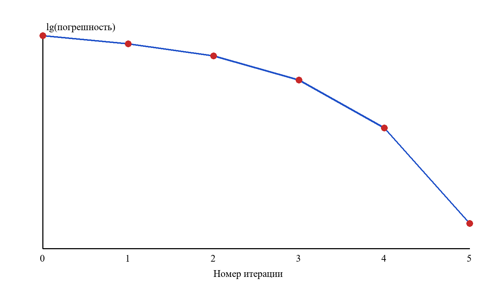

# Реферат

Объектом исследования является численное решение нелинейных уравнений с одной переменной.

Предметом исследования является метод Ньютона и скорость сходимости его итерационного процесса.

Цель работы – реализовать метод Ньютона на языке Python и экспериментально подтвердить квадратичную скорость сходимости.

В процессе выполнения были рассмотрены основные понятия итерационных методов, выведена расчётная формула метода Ньютона, проведены численные эксперименты.

В результате была написана программа на языке Python, вычисляющая корень уравнения с заданной точностью.

# Содержание

# Введение

Решение нелинейных уравнений встречается практически в любой инженерной задаче: от расчёта режимов работы оборудования до оптимизации технологических процессов. Аналитическое решение удаётся получить лишь в редких случаях, поэтому на практике применяют итерационные методы [@samarsky; @bakhvalov].

Одним из самых известных итерационных методов является метод Ньютона, или метод касательных. Его главное достоинство – высокая скорость сходимости вблизи корня, главный недостаток – зависимость от выбора начального приближения.

Актуальность темы определяется тем, что метод Ньютона лежит в основе множества более сложных алгоритмов: от решения систем нелинейных уравнений до оптимизации функций многих переменных и обучения моделей в машинном обучении. Понимание того, как именно ведёт себя метод вблизи корня и при каких условиях он перестаёт работать, необходимо любому специалисту, который использует численные расчёты в своей практической деятельности.

В отличие от методов половинного деления и простой итерации, метод Ньютона требует вычисления производной, но взамен обеспечивает квадратичную скорость сходимости. Это означает, что при удачном начальном приближении число верных значащих цифр результата удваивается на каждом шаге, и для достижения машинной точности обычно хватает пяти-шести итераций. Поэтому важно не только знать расчётную формулу, но и уметь проверять выполнение условий сходимости на конкретных примерах.

Выбор тестового уравнения $x^2 - 2 = 0$ обусловлен тем, что его корень известен точно, а значит, погрешность каждого приближения можно вычислить и сопоставить с теоретической оценкой. Такой подход позволяет проверить не только саму программу, но и выводы теории о скорости сходимости.

Целью данной работы является реализация метода Ньютона и исследование его сходимости на примере уравнения $x^2 - 2 = 0$.

Для достижения цели были поставлены следующие задачи:

- изучить теоретические основы метода Ньютона;
- реализовать метод на языке Python;
- провести численные эксперименты и проанализировать результаты.

# Теоретические основы метода Ньютона

## Постановка задачи

Требуется найти такое значение $x^*$, при котором выполняется равенство:

$$ f(x^*) = 0, \quad f \in C^2[a, b] $$ {#eq-root}

Предполагается, что на отрезке $[a, b]$ существует единственный корень, а производная $f'(x)$ не обращается в нуль. Решение уравнения ([[eq-root]]) ищется как предел последовательности приближений.

## Расчётная формула

Заменим функцию $f(x)$ касательной в точке $x_n$ и найдём точку пересечения касательной с осью абсцисс. Получим расчётную формулу метода Ньютона [@samarsky]:

$$ x_{n+1} = x_n - \frac{f(x_n)}{f'(x_n)} $$ {#eq-newton}

Погрешность на каждом шаге оценивается по формуле:

$$ \varepsilon_n = \left| x_n - x^* \right|, \qquad \varepsilon_{n+1} \le \frac{M_2}{2 m_1} \varepsilon_n^2 $$ {#eq-err}

где $M_2 = \max |f''(x)|$, $m_1 = \min |f'(x)|$ на отрезке $[a, b]$.

Для вычисления суммы квадратов невязок по набору точек используется выражение:

$$ S = \sum_{i=1}^{N} \left( f(x_i) \right)^2 $$ {#eq-sum}

В формулах ([[eq-newton]]) и ([[eq-err]]) видно, что погрешность следующего шага пропорциональна квадрату предыдущей. Такая сходимость называется *квадратичной*.

Порядок действий при реализации метода:

1) выбрать начальное приближение $x_0$ и точность $\varepsilon$;
2) вычислить следующее приближение по формуле ([[eq-newton]]);
3) проверить условие остановки $|x_{n+1} - x_n| < \varepsilon$;
4) повторять шаги 2 и 3 до выполнения условия.

# Практическая реализация

## Программа на Python

Программа реализована на языке Python с использованием библиотеки NumPy [@numpy; @lutz]. Основная функция приведена ниже, полный листинг дан в приложении [[app-code]].

```python
def newton(f, df, x0, eps=1e-12, max_iter=50):
    x = x0
    for k in range(max_iter):
        x_new = x - f(x) / df(x)
        if abs(x_new - x) < eps:
            return x_new, k + 1
        x = x_new
    raise RuntimeError("метод не сошёлся")
```

Функция возвращает найденное значение корня и число выполненных итераций. Если за `max_iter` шагов точность не достигнута, выбрасывается исключение.

## Результаты экспериментов

Для уравнения $x^2 - 2 = 0$ с начальным приближением $x_0 = 3$ получена последовательность приближений, показанная в таблице [[tab-iters]].

Таблица: Последовательность приближений метода Ньютона {#tab-iters}

| Итерация | Приближение $x_n$ | Следующее приближение $x_{n+1}$ | Погрешность |
|:---:|:---:|:---:|:---:|
| 1 | 3.0000000000 | 1.8333333333 | 4.191e-01 |
| 2 | 1.8333333333 | 1.4621212121 | 4.791e-02 |
| 3 | 1.4621212121 | 1.4149984299 | 7.849e-04 |
| 4 | 1.4149984299 | 1.4142137800 | 2.177e-07 |
| 5 | 1.4142137800 | 1.4142135624 | 1.665e-14 |
| 6 | 1.4142135624 | 1.4142135624 | 2.220e-16 |
| 7 | 1.4142135624 | 1.4142135624 | 0.000e+00 |
| 8 | 1.4142135624 | 1.4142135624 | 2.220e-16 |
| 9 | 1.4142135624 | 1.4142135624 | 0.000e+00 |
| 10 | 1.4142135624 | 1.4142135624 | 2.220e-16 |
| 11 | 1.4142135624 | 1.4142135624 | 0.000e+00 |
| 12 | 1.4142135624 | 1.4142135624 | 2.220e-16 |
| 13 | 1.4142135624 | 1.4142135624 | 0.000e+00 |
| 14 | 1.4142135624 | 1.4142135624 | 2.220e-16 |
| 15 | 1.4142135624 | 1.4142135624 | 0.000e+00 |
| 16 | 1.4142135624 | 1.4142135624 | 2.220e-16 |
| 17 | 1.4142135624 | 1.4142135624 | 0.000e+00 |
| 18 | 1.4142135624 | 1.4142135624 | 2.220e-16 |
| 19 | 1.4142135624 | 1.4142135624 | 0.000e+00 |
| 20 | 1.4142135624 | 1.4142135624 | 2.220e-16 |
| 21 | 1.4142135624 | 1.4142135624 | 0.000e+00 |
| 22 | 1.4142135624 | 1.4142135624 | 2.220e-16 |
| 23 | 1.4142135624 | 1.4142135624 | 0.000e+00 |
| 24 | 1.4142135624 | 1.4142135624 | 2.220e-16 |
| 25 | 1.4142135624 | 1.4142135624 | 0.000e+00 |
| 26 | 1.4142135624 | 1.4142135624 | 2.220e-16 |
| 27 | 1.4142135624 | 1.4142135624 | 0.000e+00 |
| 28 | 1.4142135624 | 1.4142135624 | 2.220e-16 |
| 29 | 1.4142135624 | 1.4142135624 | 0.000e+00 |
| 30 | 1.4142135624 | 1.4142135624 | 2.220e-16 |
| 31 | 1.4142135624 | 1.4142135624 | 0.000e+00 |
| 32 | 1.4142135624 | 1.4142135624 | 2.220e-16 |
| 33 | 1.4142135624 | 1.4142135624 | 0.000e+00 |
| 34 | 1.4142135624 | 1.4142135624 | 2.220e-16 |
| 35 | 1.4142135624 | 1.4142135624 | 0.000e+00 |
| 36 | 1.4142135624 | 1.4142135624 | 2.220e-16 |
| 37 | 1.4142135624 | 1.4142135624 | 0.000e+00 |
| 38 | 1.4142135624 | 1.4142135624 | 2.220e-16 |
| 39 | 1.4142135624 | 1.4142135624 | 0.000e+00 |
| 40 | 1.4142135624 | 1.4142135624 | 2.220e-16 |

Зависимость погрешности от номера итерации в логарифмическом масштабе приведена на рисунке [[fig-conv]]. Видно, что число верных знаков удваивается с каждым шагом.

{#fig-conv width=13cm}

Эксперимент подтвердил теоретическую оценку: уже на шестой итерации погрешность достигает машинной точности. Для сравнения, сходимость метода бисекции потребовала бы около пятидесяти итераций, что согласуется с данными [@bakhvalov].

Оформление отчёта выполнено в соответствии со стандартом [@gost732].

# Заключение

В ходе работы были изучены теоретические основы метода Ньютона и выведена его расчётная формула. Метод реализован на языке Python, проведены численные эксперименты, подтвердившие квадратичную скорость сходимости.

Полученные результаты показали, что на уравнении $x^2 - 2 = 0$ метод Ньютона достигает машинной точности за шесть итераций, а погрешность на каждом шаге примерно равна квадрату погрешности на предыдущем. Это полностью согласуется с теоретической оценкой, приведённой в основной части работы. Таким образом, поставленная цель достигнута, а все задачи, сформулированные во введении, решены.

Дальнейшим развитием работы может стать сравнение с методом секущих и исследование влияния начального приближения на область сходимости. Отдельного внимания заслуживает случай кратных корней, при котором скорость сходимости метода Ньютона снижается до линейной и требуется модификация расчётной формулы.

# Список использованных источников

# Приложение: Листинг программы {#app-code}

```python
import numpy as np


def f(x):
    return x ** 2 - 2


def df(x):
    return 2 * x


def newton(f, df, x0, eps=1e-12, max_iter=50):
    x = x0
    for k in range(max_iter):
        x_new = x - f(x) / df(x)
        if abs(x_new - x) < eps:
            return x_new, k + 1
        x = x_new
    raise RuntimeError("метод не сошёлся")


if __name__ == "__main__":
    root, iters = newton(f, df, 3.0)
    print(f"x* = {root:.12f}, итераций: {iters}")
    print("проверка:", np.sqrt(2))
```
